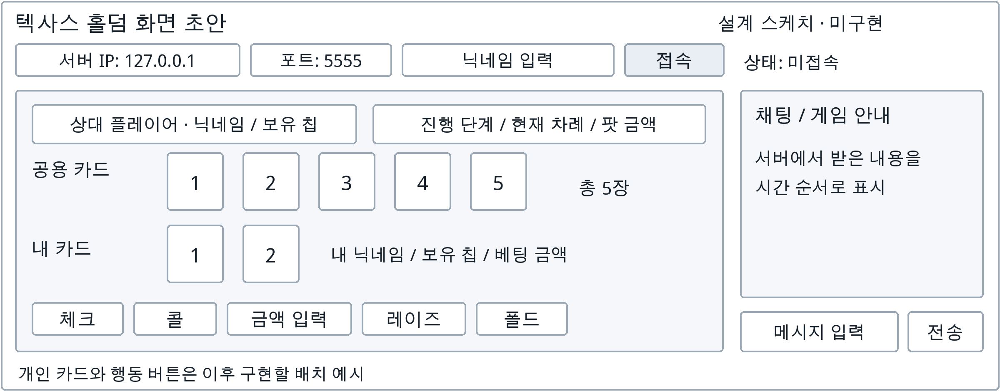

# 텍사스 홀덤 1주차 설계 초안

팀 37 / 송준석, 표신현

## 이번 주 범위

주요 규칙과 화면 배치를 정리하고 서버·클라이언트의 역할을 나눕니다.
참가 요청과 승인 메시지 두 개만 초안으로 정의합니다.
실행 가능한 코드는 한 명과 콘솔 문자열을 주고받는 TCP 실습까지입니다.
아래 화면과 참가 규약은 아직 Java 코드에 구현하지 않았습니다.

## 개발 순서

교수님 안내에 따라 다음 순서를 기준으로 삼고, 팀 진행 상황에 맞게 조정합니다.

1. 게임의 주요 기능과 규칙을 정리합니다.
2. 그림이나 간단한 스케치로 화면 초안을 만듭니다.
3. 서버와 클라이언트의 역할을 나누고 필요한 프로토콜 초안을 정의합니다.
4. 기본 화면과 기본 통신을 구현하고 확인합니다.
5. 기능별로 나누어 확장하며, 작은 기능을 자주 합쳐 통합 테스트합니다.

모든 규약을 이번 주에 정할 필요는 없습니다. 화면과 통신 구현은 병행할 수 있습니다.
수업의 다중 클라이언트 코드를 출발점으로 삼아 accept 반복과 연결별 Thread를 읽고
적용하는 것이 다음 확인 과제입니다. 이 ZIP의 Java 코드는 수업 원본의 복사본이 아니며,
현재는 한 번의 접속만 처리하는 별도 통신 실습입니다.

## 게임 규칙과 화면 초안

- 한 테이블에서 2~6명이 가상 칩을 사용하는 텍사스 홀덤을 목표로 합니다.
- 개인 카드 2장과 공용 카드 5장 중 5장으로 족보를 비교합니다.
- 상대의 개인 카드는 승부 공개 전까지 숨깁니다.
- 체크, 콜, 레이즈, 폴드를 기본 행동으로 둡니다.
- 블라인드, 최소 레이즈, 올인·사이드 팟 등 세부 베팅 규칙은 이후 구체화합니다.

이 그림은 실행 화면이 아닌 스케치입니다. IP·포트·닉네임 입력, 상대 정보, 공용 카드,
내 카드, 행동 버튼과 채팅·안내 영역을 배치합니다. 처음에는 접속 입력과 상태 표시부터 구현합니다.

## 역할 분담

| 팀원 | 1주차 역할 | 이후 확장할 역할 |
|---|---|---|
| 송준석 | 서버의 접속 대기·수신·응답 이해, 서버 역할과 참가 규약 초안 | 다중 접속, 참가자 관리, 카드 배분, 차례와 베팅 검사, 승패 판정 |
| 표신현 | 클라이언트 연결·입력·송수신 이해, 화면 배치 초안 | Swing 기본 화면, 수신 Thread, 게임 상태 표시와 입력 처리 |
| 공동 | 주요 규칙·메시지 형식 검토, 실행 결과 비교 | 작은 기능 통합, 두 클라이언트 테스트, 오류 처리 규칙 검토 |

서버는 최종 게임 상태와 행동 가능 여부를 판단합니다.
클라이언트는 사용자 입력을 전송하고 서버가 보낸 상태를 표시합니다.
다른 플레이어의 개인 카드를 모든 클라이언트에 보내지 않는 구조로 설계합니다.

## 응용 계층 프로토콜 초안

수업의 예시 표 항목에 맞춰 참가 기능 두 개만 정리했습니다.
UTF-8 한 줄을 한 메시지로 하며, 명령어와 값은 공백으로 구분합니다.
닉네임은 이 초안에서 공백과 줄바꿈을 허용하지 않습니다.
ID는 서버가 접속과 연결해 배정하고, 클라이언트가 다른 사람의 ID를 임의로 정하지 않습니다.

| 기능 | 프로토콜 | 프로토콜 형식 | 실제 예시 | 각 값의 의미 | 전송 방향 | 전송 시점 | 수신 후 처리 |
|---|---|---|---|---|---|---|---|
| 게임 참가 요청 | /JOIN | /JOIN 닉네임 | /JOIN 준석 | 준석은 참가 닉네임 | 클라이언트 → 서버 | TCP 연결 후 참가 요청 시 | 닉네임 중복 확인 후 사용자 등록과 ID 배정 |
| 게임 참가 승인 | /JOIN_OK | /JOIN_OK 플레이어ID | /JOIN_OK 1 | 1은 서버가 배정한 ID | 서버 → 요청자 | 참가를 승인한 뒤 | 자신의 ID를 저장하고 참가 완료 표시 |

표의 '실제 예시'는 형식을 설명하는 예시 값이며 실행 결과가 아닙니다.
중복 닉네임을 거절하는 응답과 채팅, 카드 전달, 게임 행동 및 종료 메시지는 이후 정의합니다.
수업 예시의 /MOVE는 이동 게임용이므로 이번 홀덤 초안에는 넣지 않았습니다.

### 현재 구현된 통신과의 차이

현재 Java 코드는 참가 명령을 해석하지 않습니다.
`/JOIN 준석`을 전송하면 원문인 `/JOIN 준석`을 그대로 응답합니다.
현재 구현은 UTF-8 한 줄 단위의 에코 통신이며 별도의 접속 안내나 종료 응답은 없습니다.
클라이언트의 `QUIT`은 서버에 보내지 않고 연결을 닫는 로컬 명령입니다.
테스트 로그는 문자열 통신을 확인한 결과이며 참가 등록이나 다중 접속 성공의 증거는 아닙니다.

## 다음 단계와 작은 단위의 통합 테스트 계획

1. 수업 다중 클라이언트 예제의 서버 접속 반복과 Thread 구조를 읽습니다.
2. 서버 1개와 클라이언트 2개를 실행해 서로의 입력 때문에 통신이 멈추지 않는지 봅니다.
3. /JOIN과 /JOIN_OK를 맞춘 뒤 서로 다른 두 닉네임에 고유 ID가 배정되는지 확인합니다.
4. 접속 입력·상태 표시 화면을 붙이고 서버 응답이 올바르게 표시되는지 봅니다.
5. 닉네임 중복, 연결 종료, 서버 미실행 조건을 합의한 규칙에 맞춰 검사합니다.

각 단계는 합친 뒤 테스트하고 다음 단계로 진행합니다.
기본 구조가 동작한 뒤 카드 배분, 차례 처리, 베팅과 채팅을 나누어 추가합니다.

## 참고한 안내

- 교수님의 개발 순서 안내: 화면 스케치, 역할 분담, 통신 규약 초안, 기본 구현, 기능별 확장과 잦은 통합 테스트.
- 수업에 제시된 응용 계층 프로토콜 예시 표의 8개 항목.
- 주차별 보고서 작성 안내의 개인 담당 코드, 동작 흐름, 실행 근거와 다음 계획 항목.
